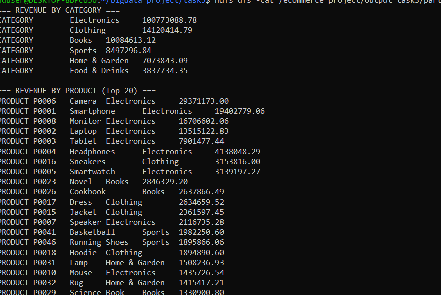
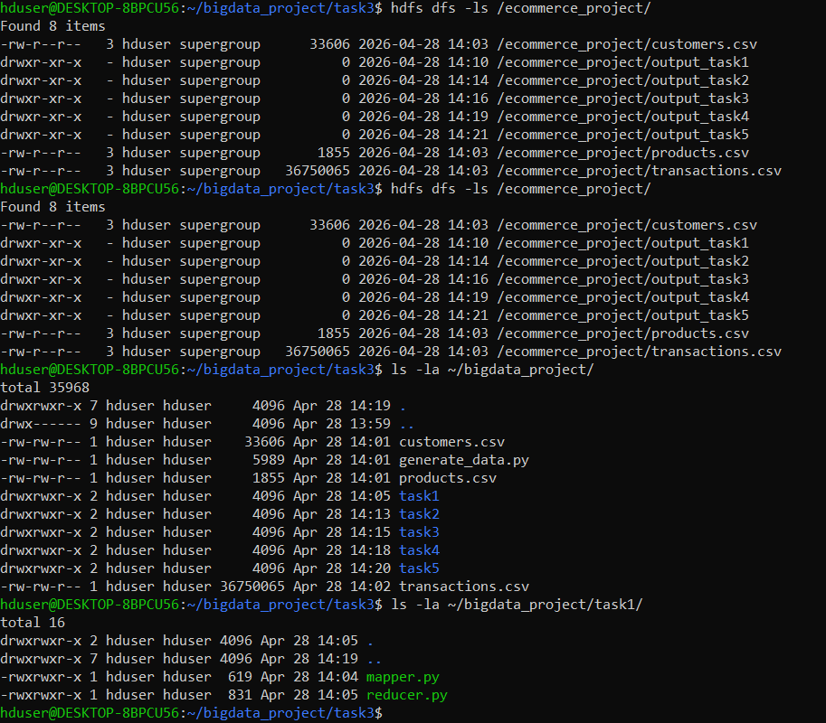
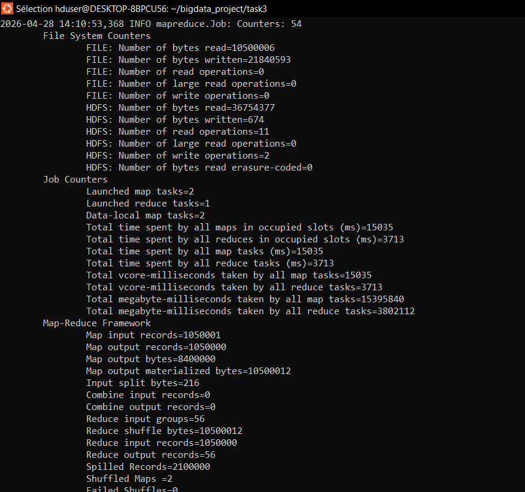

# Analyse e-commerce Big Data — Hadoop MapReduce

> *Big Data pipeline on 1M+ e-commerce transactions with Hadoop HDFS and MapReduce (Python streaming).*

Pipeline complet d'analyse des ventes d'une boutique en ligne : génération d'un jeu de données de **1 050 000 transactions**, chargement dans **HDFS**, puis **5 jobs MapReduce** écrits en Python et exécutés avec Hadoop Streaming sur un cluster pseudo-distribué (WSL / Ubuntu).

## Questions métier traitées

| Job | Question | Clé émise par le mapper | Sortie du reducer |
|---|---|---|---|
| `task1_top_products` | Quels produits se vendent le plus ? | `product_id → quantité` | Quantité totale par produit |
| `task2_active_customers` | Qui sont les clients les plus actifs ? | `customer_id → 1` | Nombre de transactions par client |
| `task3_revenue` | Quel chiffre d'affaires par catégorie et par produit ? | `product_id → CA` (jointure avec `products.csv` via le **cache distribué**) | CA par catégorie + top 20 produits |
| `task4_monthly_trends` | Comment évoluent les ventes mois par mois ? | `AAAA-MM → quantité` | Quantité et nombre de transactions par mois |
| `task5_bought_together` | Quels produits sont achetés ensemble ? | `client,date → produit` (session d'achat) | Top 30 des paires de produits |

## Résultats (jeu complet, 1 050 000 transactions)

**Chiffre d'affaires par catégorie** (`task3_revenue`)

| Catégorie | CA |
|---|---:|
| Electronics | 100 773 088,78 |
| Clothing | 14 120 414,79 |
| Books | 10 084 613,12 |
| Sports | 8 497 296,84 |
| Home & Garden | 7 073 843,09 |
| Food & Drinks | 3 837 734,35 |

**Autres enseignements**
- Les livres dominent en volume (*Novel* : 199 044 unités, *Cookbook* : 115 241), alors que l'électronique domine en valeur.
- Ventes mensuelles stables sur 24 mois (2023–2024), entre ~76 000 et ~85 000 unités par mois.
- Paire la plus fréquente : *Novel + Cookbook*, achetés ensemble dans 13 966 sessions.



## Architecture

```
generate_data.py ──► customers.csv / products.csv / transactions.csv
                                   │  hdfs dfs -put
                                   ▼
                     HDFS : /ecommerce_project/
                                   │  hadoop jar hadoop-streaming.jar
                                   ▼
        mapper.py (stdin → clé\tvaleur) ─► shuffle & sort ─► reducer.py (agrégation)
                                   │
                                   ▼
                  HDFS : /ecommerce_project/output_taskN/part-00000
```

## Lancer le projet

**1. En local (sans Hadoop), sur l'échantillon fourni** — simule MapReduce avec `cat | mapper | sort | reducer` :

```bash
./scripts/run_local.sh            # résultats dans output/
```

**2. Sur Hadoop** (HDFS + YARN démarrés, `HADOOP_HOME` défini) :

```bash
python3 data_gen/generate_data.py   # génère le jeu complet (~37 Mo) dans data_gen/
./scripts/run_hadoop.sh             # upload HDFS + 5 jobs streaming
```

Le guide pas à pas complet (installation, upload HDFS, tests locaux, exécution de chaque job) est dans [`docs/GUIDE.md`](docs/GUIDE.md).

## Structure

```
data_gen/generate_data.py     # générateur reproductible (seed 42) : 1 000 clients, 56 produits, 1,05 M transactions
data/sample/                  # échantillon de 500 lignes pour tester rapidement
task1_top_products/ … task5_bought_together/   # mapper.py + reducer.py par job
scripts/run_local.sh          # exécution locale des 5 jobs
scripts/run_hadoop.sh         # exécution sur le cluster Hadoop
docs/                         # guide et captures d'écran
```

## Captures

| HDFS | Compteurs d'un job MapReduce |
|---|---|
|  |  |

## Compétences mises en œuvre

Hadoop HDFS · MapReduce · Hadoop Streaming · cache distribué (jointure côté map) · Python · Linux / WSL · modélisation clé-valeur · analyse de données de ventes

---

Projet académique — Licence Informatique (spécialisation Big Data), TED University, 2026 · **Luca Raciti** · [LinkedIn](https://www.linkedin.com/in/raciti-luca)
